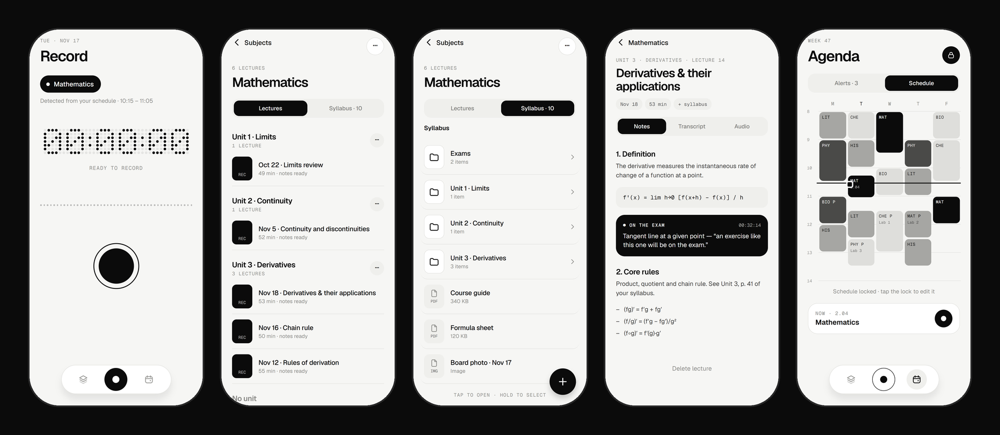
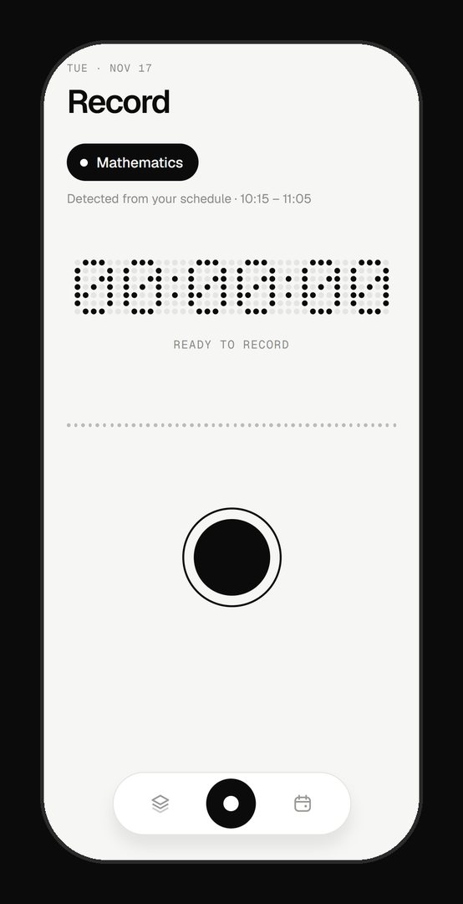
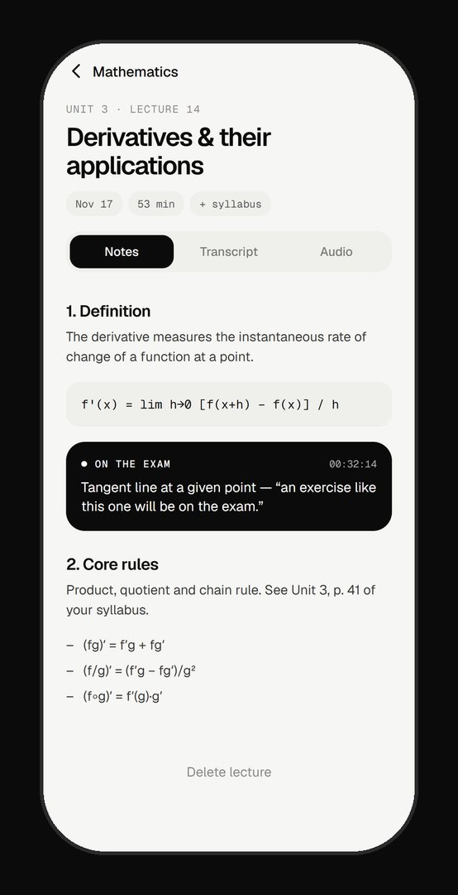
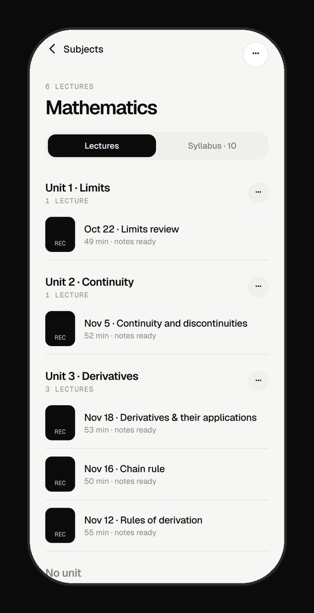
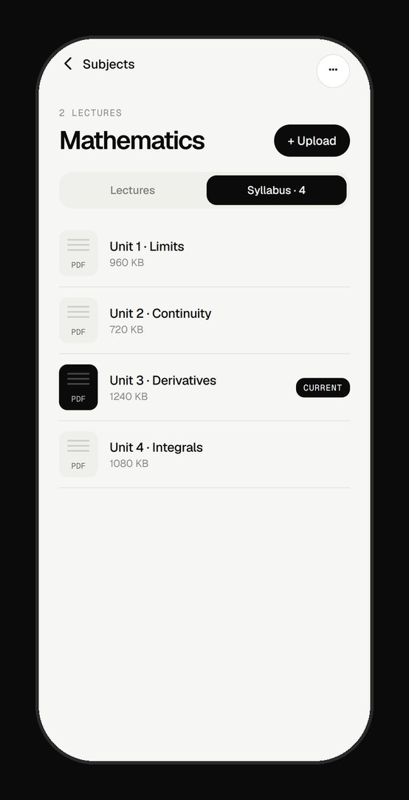
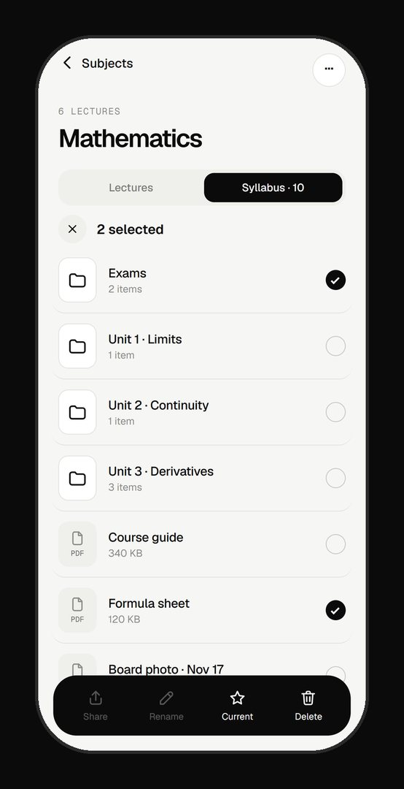
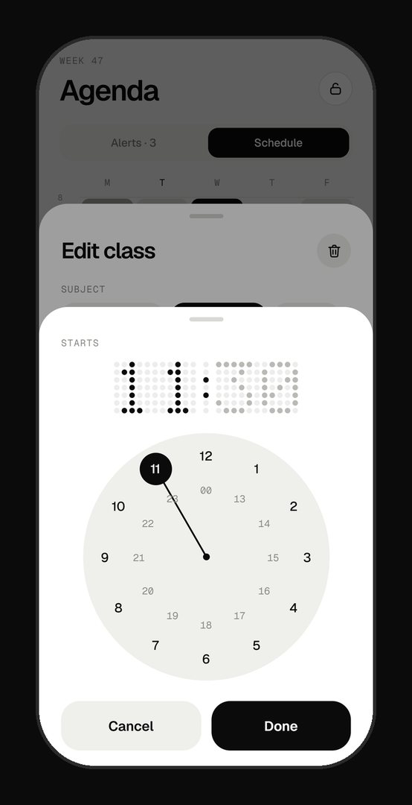
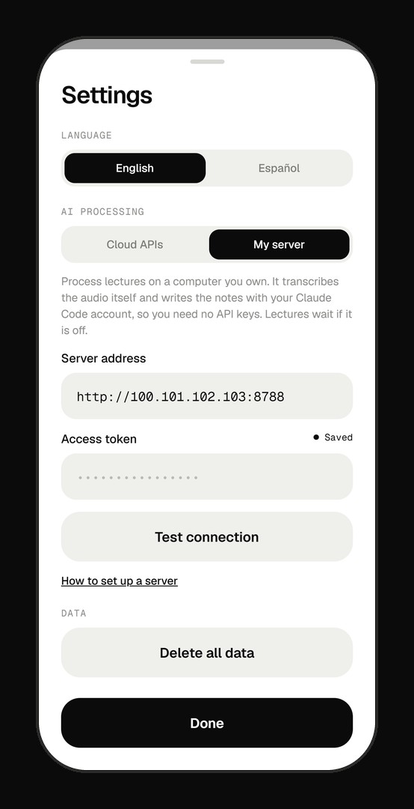

<p align="center">
  <picture>
    <source media="(prefers-color-scheme: dark)" srcset="docs/logo-dark.png">
    
  </picture>
</p>

<p align="center">
  <b>Record your lecture. Get your notes.</b><br>
  You pay attention in class. Classcribe writes everything down.
</p>

<p align="center">
  
  
  
  
  
  
</p>

<p align="center">
  <a href="https://github.com/iago-df/classcribe/releases/latest/download/Classcribe.apk"><b>⬇ Download for Android</b></a>
  &nbsp;·&nbsp;
  <a href="https://iago-df.github.io/classcribe/">▶ Watch the promo video</a>
</p>

<p align="center">
  <a href="https://iago-df.github.io/classcribe/"></a><br>
  <sub>▶ <a href="https://iago-df.github.io/classcribe/">Watch the full promo video (45 s, with sound)</a></sub>
</p>

<p align="center">
  
</p>

> [!NOTE]
> The video and screenshots use sample data. The app comes in English (default) and Spanish; switch it in settings.

## Install on Android

No building needed. Android 7.0 or newer.

1. On your phone, download **[Classcribe.apk](https://github.com/iago-df/classcribe/releases/latest/download/Classcribe.apk)** (it is also on the [Releases](https://github.com/iago-df/classcribe/releases) page).
2. Open the file. If Android asks, allow your browser or file manager to **install unknown apps**.
3. If Play Protect says the app is not recognised, tap **More details → Install anyway**. It says that about any app that does not come from the Play Store.
4. Open Classcribe, tap the gear on the Subjects screen and [choose how to process your lectures](#choose-how-lectures-are-processed).

Each release lists the SHA-256 of the APK, so you can check that the file you downloaded is the original. There is no iPhone build to download; you can build it yourself on a Mac (see [Build from source](#build-from-source)).

## Why

A lecture lasts 60 minutes. Your notes? Five lines.

You can either listen or write, not both. Classcribe records the lecture, transcribes it and writes proper notes from it, using the syllabus you uploaded so concepts are named the way your course names them. It also catches the moments that matter, like *"this will be on the exam"* or *"exercises 4 to 7 for Thursday"*, and puts them in your agenda with a link to the exact second it was said.

## Features

<table>
  <tr>
    <td width="50%"></td>
    <td width="50%"></td>
  </tr>
  <tr>
    <td valign="top">
      <h3>Record</h3>
      One big button. Classcribe already knows which class you are in from your schedule, so you just hit record. A dot-matrix timer and a live waveform show it is listening, and it keeps recording with the screen off. When you stop, confirm the subject and save.
    </td>
    <td valign="top">
      <h3>Notes</h3>
      Structured notes with sections, formulas and lists, written in the language the lecture was given in. Anything the professor flags for the exam gets its own black callout. Switch to the full transcript or the audio; tap any timestamp to jump there.
    </td>
  </tr>
  <tr>
    <td></td>
    <td></td>
  </tr>
  <tr>
    <td valign="top">
      <h3>Units</h3>
      Inside a subject, you split the lectures into your own units. New lectures land in the right unit on their own when the AI can tell, and you can always move them with a long press.
    </td>
    <td valign="top">
      <h3>Syllabus</h3>
      Folders inside folders, or loose files: PDFs, photos of the board, text. Tap a file to read it inside the app, with its own PDF reader. Mark the files of the unit you are on as <i>current</i> and only those go with the next lectures.
    </td>
  </tr>
  <tr>
    <td></td>
    <td></td>
  </tr>
  <tr>
    <td valign="top">
      <h3>Select and move</h3>
      Hold a file or folder to select it, tap to add more. Drag the selection onto a folder, or onto the bar that appears on top to take it out. The bottom bar shares, renames, marks as current or deletes (always asking first).
    </td>
    <td valign="top">
      <h3>Class editor</h3>
      Subject, theory or practice, day, room and colour, in one sheet that never scrolls. Times are picked on a round clock: hours first, then minutes.
    </td>
  </tr>
  <tr>
    <td></td>
    <td></td>
  </tr>
  <tr>
    <td valign="top">
      <h3>Alerts</h3>
      Exams, homework and notices the professor said out loud, with their real quote, the due date (relative dates like "next Thursday" are resolved) and a ▶ link to that second of the recording. Tick them off when done.
    </td>
    <td valign="top">
      <h3>Schedule</h3>
      Build your week once: tap an empty slot and fill in the class. Theory and practice can have different shades, and practice classes carry a <b>P</b>. When the semester is set, lock it so nothing changes by accident.
    </td>
  </tr>
  <tr>
    <td></td>
    <td></td>
  </tr>
  <tr>
    <td valign="top">
      <h3>Subjects</h3>
      One card per subject, made from your schedule. A subject turns black with a <b>● NEW</b> tag when it has notes you have not opened yet, and goes back to white once you read them.
    </td>
    <td valign="top">
      <h3>Settings</h3>
      Language, and how your lectures are processed: <b>Cloud APIs</b> with your own Anthropic and OpenAI keys (the default), or <b>My server</b>, a computer of yours that does it with your Claude Code account. Switch whenever you want. See <a href="#choose-how-lectures-are-processed">how they compare</a>.
    </td>
  </tr>
</table>

## How it works

```
 record (m4a, mono, 16 kHz, 32 kbps)
   │
   ├─▶ OpenAI Whisper ─────────▶ transcript with [hh:mm:ss] segments
   │
   └─▶ Claude Opus 5.5 ◀──────── transcript + your syllabus (PDF / images / text)
           │
           ├─ notes:  headings, paragraphs, lists, formulas, exam callouts
           ├─ unit:   which syllabus unit the lecture covers
           └─ alerts: exam / homework / notice, quote, second, due date
```

- **Whisper** (`whisper-1`) is used because it returns segment timestamps. That is what lets every alert and exam callout point to the exact second.
- **Claude** gets the transcript and the syllabus in one request and answers with a strict JSON schema (structured outputs), so the app never has to guess what came back. The syllabus is cached between lectures of the same subject.
- Alerts are only created when the professor says something explicitly; the prompt tells the model to leave anything doubtful out.
- A 60 minute lecture is about 14 MB, under Whisper's 25 MB upload limit.

## Build from source

Only if you want to run or change the code. You need Node 20+, plus Android Studio for Android or Xcode on a Mac for iOS.

```bash
git clone https://github.com/iago-df/classcribe.git
cd classcribe
npm install
npx expo run:android   # or, on a Mac: npx expo run:ios
```

`run:android` builds the native app and installs it on a phone connected by USB or on an emulator. The first build takes a while. After that, `npx expo start` is enough while you only change the TypeScript code. Expo Go does not work, because recording with the screen off needs native modules.

`npx expo start --web` opens the app in the browser. It is handy to look around the UI, but recording and secure storage only work on a phone.

> [!WARNING]
> **Building on Windows.** React Native compiles C++ code with very long file paths, and the `ninja` that comes with the Android SDK's CMake 3.22.1 can't handle paths over 260 characters. The build then stops with `ninja: error: mkdir(...): No such file or directory`. macOS and Linux are not affected. To fix it:
>
> 1. Clone the repo into a short folder, such as `C:\cb`.
> 2. Install a newer ninja: `pip install ninja` (1.12 or newer).
> 3. Copy `%LOCALAPPDATA%\Android\Sdk\cmake\3.22.1` somewhere, and replace `bin\ninja.exe` in the copy with the new one.
> 4. Point the build at the copy in `android\local.properties` (the `android` folder appears after the first `npx expo run:android`):
>    ```properties
>    cmake.dir=C\:/path/to/the/cmake-copy
>    ```
> 5. Run `npx expo run:android` again.

## Choose how lectures are processed

Pick one in **Settings → AI processing**. You can change it whenever you want.

| | Cloud APIs (default) | My server |
|---|---|---|
| **Best for** | Getting started in two minutes | People with a computer that stays on |
| **You need** | An Anthropic and an OpenAI API key | A computer with Claude Code and the [Classcribe server](server/README.md) |
| **You pay** | Per lecture, to each API | Nothing extra; it uses your Claude plan's limits |
| **Transcription** | OpenAI Whisper | On your computer |
| **Notes** | Claude, through the API | Claude, through Claude Code |
| **If it is unavailable** | The lecture shows an error to retry | The lecture waits until the server is back |

### API keys

Open **Settings** (the gear on the Subjects screen) and paste:

| Key | Used for | Get one |
|---|---|---|
| Anthropic API key | writing the notes and alerts | [console.anthropic.com](https://console.anthropic.com) |
| OpenAI API key | transcribing the audio | [platform.openai.com](https://platform.openai.com) |

Keys are kept in the device's secure storage (Keychain / Keystore) and are only sent to their own API.

### My server

Run the server on your own computer, then paste its address and token in **Settings → My server**. The [server guide](server/README.md) walks you through it step by step.

## Privacy

Classcribe has no accounts and no servers of its own. Subjects, schedule, notes and recordings live on your phone. A recording leaves the device only when it is processed:

- **Cloud APIs:** the audio goes to OpenAI for the transcript, and the transcript plus that subject's syllabus go to Anthropic for the notes.
- **My server:** the audio and the syllabus go to your computer. The transcript and the syllabus reach Anthropic through Claude Code; the audio stays with you and is deleted once it is transcribed.

Check your university's rules before recording a lecture, and ask the professor if in doubt.

## Project layout

```
src/
├─ app/                    screens (expo-router)
│  ├─ (tabs)/              subjects · record · agenda + the floating pill nav
│  ├─ subject/[id].tsx     units with their lectures, and the syllabus
│  ├─ lecture/[id].tsx     notes · transcript · audio
│  ├─ file/[id].tsx        in-app reader for syllabus files
│  ├─ block.tsx            add / edit a class in the schedule (sheet)
│  └─ settings.tsx         language, APIs or your server, data (sheet)
├─ components/             Syllabus (folders, selection, drag and drop), Sheet, ClockPicker,
│                          dot-matrix timer, waveform, week grid, alert card, ui kit
├─ lib/
│  ├─ ai/                  transcribe.ts (Whisper), notes.ts (Claude), server.ts (your server),
│  │                       process.ts (pipeline)
│  ├─ files.ts             recordings and syllabus files on disk
│  └─ time.ts              schedule helpers: current class, week number, formats
├─ i18n/                   en.ts (default), es.ts
└─ store.ts                zustand store persisted on the device
server/                    optional self-hosted processing server (Python)
scripts/make-brand.py      generates the logo and app icons
```

## Status

Personal project, built for my own lectures. Things I would like to add:

- Splitting recordings longer than ~100 minutes so they fit the transcription limit
- Processing in the background when the app is closed
- Exporting notes as PDF

## License

[MIT](LICENSE)
