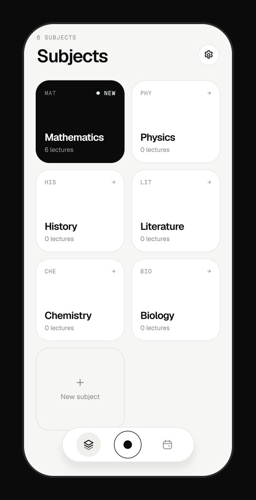
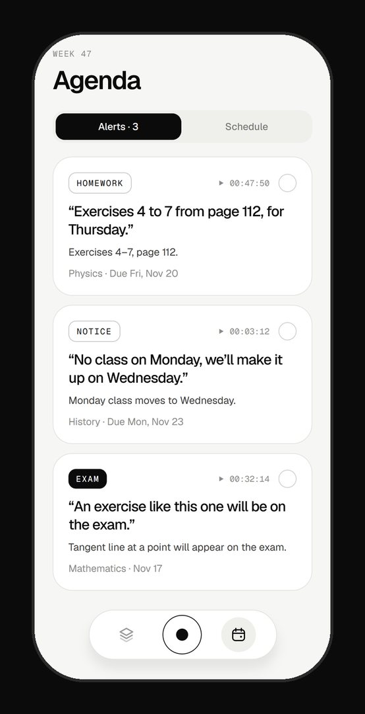
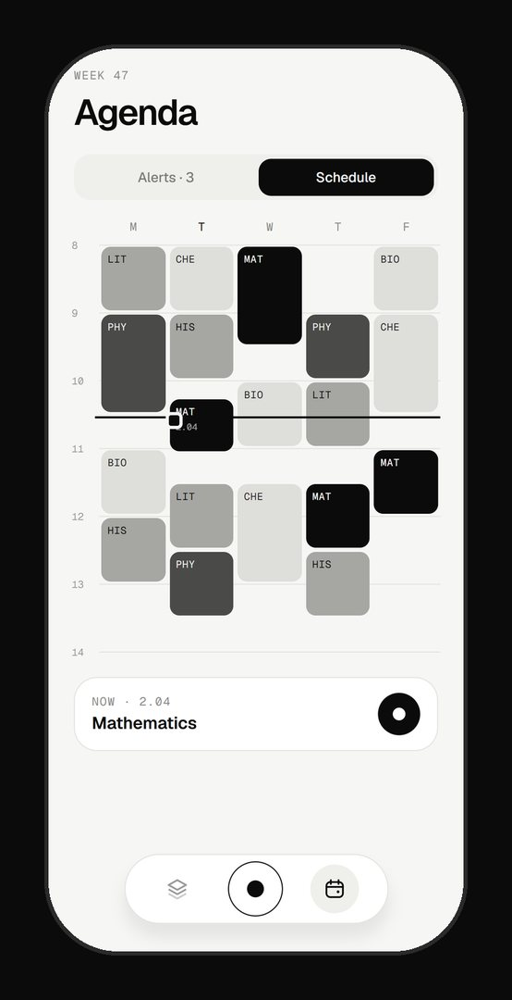

<p align="center">
  <picture>
    <source media="(prefers-color-scheme: dark)" srcset="docs/logo-dark.png">
    
  </picture>
</p>

<p align="center">
  <b>Record your lecture. Get your notes.</b><br>
  You pay attention in class. Classcribe writes everything down.
</p>

<p align="center">
  
  
  
  
  
  
</p>

<p align="center">
  
</p>

> [!NOTE]
> The screenshots use sample data. The app comes in English (default) and Spanish; switch it in settings.

## Install on Android

No building needed. Android 7.0 or newer.

1. On your phone, download **[Classcribe.apk](https://github.com/iago-df/classcribe/releases/latest/download/Classcribe.apk)** (it is also on the [Releases](https://github.com/iago-df/classcribe/releases) page).
2. Open the file. If Android asks, allow your browser or file manager to **install unknown apps**.
3. If Play Protect says the app is not recognised, tap **More details → Install anyway**. It says that about any app that does not come from the Play Store.
4. Open Classcribe, tap the gear on the Subjects screen and add your [API keys](#api-keys).

Each release lists the SHA-256 of the APK, so you can check that the file you downloaded is the original. There is no iPhone build to download; you can build it yourself on a Mac (see [Build from source](#build-from-source)).

## Why

A lecture lasts 60 minutes. Your notes? Five lines.

You can either listen or write, not both. Classcribe records the lecture, transcribes it and writes proper notes from it, using the syllabus you uploaded so concepts are named the way your course names them. It also catches the moments that matter, like *"this will be on the exam"* or *"exercises 4 to 7 for Thursday"*, and puts them in your agenda with a link to the exact second it was said.

## Features

<table>
  <tr>
    <td width="50%"></td>
    <td width="50%"></td>
  </tr>
  <tr>
    <td valign="top">
      <h3>Record</h3>
      One big button. Classcribe already knows which class you are in from your schedule, so you just hit record. A dot-matrix timer and a live waveform show it is listening, and it keeps recording with the screen off. When you stop, confirm the subject and save.
    </td>
    <td valign="top">
      <h3>Notes</h3>
      Structured notes with sections, formulas and lists, written in the language the lecture was given in. Anything the professor flags for the exam gets its own black callout. Switch to the full transcript or the audio; tap any timestamp to jump there.
    </td>
  </tr>
  <tr>
    <td></td>
    <td></td>
  </tr>
  <tr>
    <td valign="top">
      <h3>Subjects</h3>
      One card per subject. Subjects with fresh notes turn black. Inside, lectures are grouped by the syllabus unit the AI matched them to.
    </td>
    <td valign="top">
      <h3>Syllabus</h3>
      Upload PDFs, photos of the board or text files per subject. Mark the unit you are on as <i>current</i> and only that one is sent with the next lectures.
    </td>
  </tr>
  <tr>
    <td></td>
    <td></td>
  </tr>
  <tr>
    <td valign="top">
      <h3>Alerts</h3>
      Exams, homework and notices the professor said out loud, with their real quote, the due date (relative dates like "next Thursday" are resolved) and a ▶ link to that second of the recording. Tick them off when done.
    </td>
    <td valign="top">
      <h3>Schedule</h3>
      Build your week once: tap an empty slot, pick the subject, times and room. Four shades of grey, a line for <i>now</i>, and a shortcut to record the class you are in.
    </td>
  </tr>
</table>

## How it works

```
 record (m4a, mono, 16 kHz, 32 kbps)
   │
   ├─▶ OpenAI Whisper ─────────▶ transcript with [hh:mm:ss] segments
   │
   └─▶ Claude Opus 5.5 ◀──────── transcript + your syllabus (PDF / images / text)
           │
           ├─ notes:  headings, paragraphs, lists, formulas, exam callouts
           ├─ unit:   which syllabus unit the lecture covers
           └─ alerts: exam / homework / notice, quote, second, due date
```

- **Whisper** (`whisper-1`) is used because it returns segment timestamps. That is what lets every alert and exam callout point to the exact second.
- **Claude** gets the transcript and the syllabus in one request and answers with a strict JSON schema (structured outputs), so the app never has to guess what came back. The syllabus is cached between lectures of the same subject.
- Alerts are only created when the professor says something explicitly; the prompt tells the model to leave anything doubtful out.
- A 50 minute lecture is about 12 MB, under Whisper's 25 MB upload limit.

## Getting started

You need Node 20+ and either a phone with a development build or an emulator.

```bash
git clone https://github.com/iago-df/classcribe.git
cd classcribe
npm install
npx expo start
```

Recording with the screen off needs native modules, so use a development build rather than Expo Go:

```bash
npx expo run:android   # or: npx expo run:ios
```

The web build (`npx expo start --web`) is handy to look around the UI.

### API keys

Open **Settings** (the gear on the Subjects screen) and paste:

| Key | Used for | Get one |
|---|---|---|
| Anthropic API key | writing the notes and alerts | [console.anthropic.com](https://console.anthropic.com) |
| OpenAI API key | transcribing the audio | [platform.openai.com](https://platform.openai.com) |

Keys are kept in the device's secure storage (Keychain / Keystore) and are only sent to their own API.

## Privacy

There is no Classcribe server. Subjects, schedule, notes and recordings live on your phone. A recording leaves the device only when it is processed: the audio goes to OpenAI for the transcript, and the transcript plus that subject's syllabus go to Anthropic for the notes. Check your university's rules before recording a lecture, and ask the professor if in doubt.

## Project layout

```
src/
├─ app/                    screens (expo-router)
│  ├─ (tabs)/              subjects · record · agenda + the floating pill nav
│  ├─ subject/[id].tsx     lectures and syllabus of a subject
│  ├─ lecture/[id].tsx     notes · transcript · audio
│  ├─ block.tsx            add / edit a class in the schedule
│  └─ settings.tsx         language, API keys, data
├─ components/             dot-matrix timer, waveform, week grid, alert card, ui kit
├─ lib/
│  ├─ ai/                  transcribe.ts (Whisper), notes.ts (Claude), process.ts (pipeline)
│  ├─ files.ts             recordings and syllabus files on disk
│  └─ time.ts              schedule helpers: current class, week number, formats
├─ i18n/                   en.ts (default), es.ts
└─ store.ts                zustand store persisted on the device
scripts/make-brand.py      generates the logo and app icons
```

## Status

Personal project, built for my own lectures. Things I would like to add:

- Splitting recordings longer than ~100 minutes so they fit the transcription limit
- Processing in the background when the app is closed
- Exporting notes as PDF

## License

[MIT](LICENSE)
